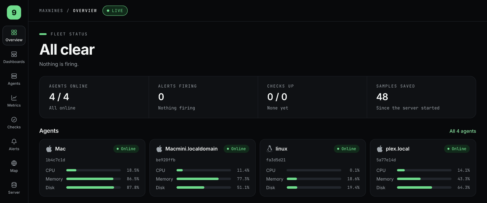
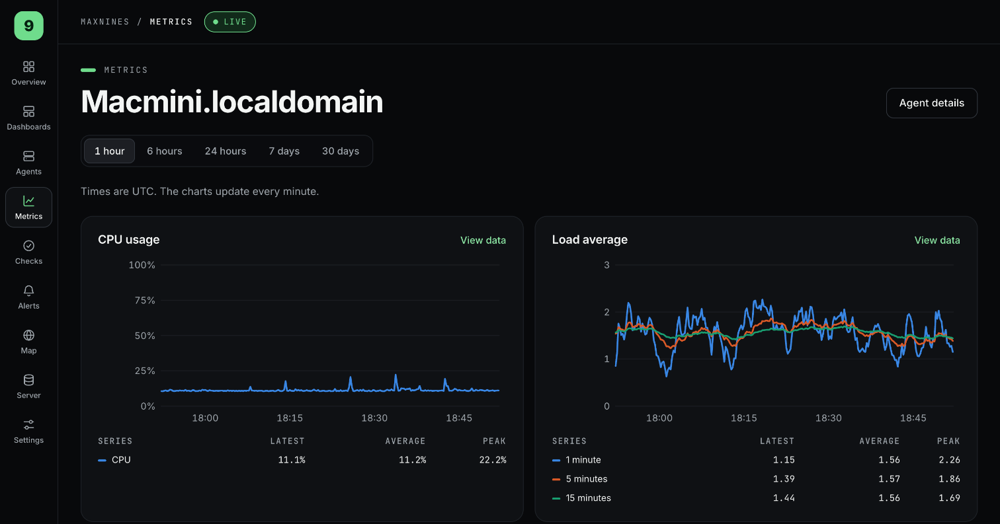

# MaxNines

MaxNines is fast, low-resource, open source monitoring software, written in Rust.
It's meant to be running and useful within minutes of installing it, with great
defaults instead of a pile of configuration.

## Goals

- **Fast and light.** A small agent that barely registers on the hosts it
  watches, and a server that handles a large fleet on modest hardware.
- **Quick to set up.** Install the server, add agents, and see useful charts and
  alerts straight away.
- **Great defaults.** The things most people need to watch are covered out of the
  box, with sensible alerts, so configuration is for fine-tuning rather than
  getting started.
- **Open source and self-hosted.** It runs on your own servers and your data stays
  with you.

MaxNines is in early development and isn't ready for production use yet.

## Documentation

The [documentation](docs/SUMMARY.md) covers installing, setting up and using
MaxNines. Every server also shows it on its Docs page, matching the version it runs.
Start with [Installing](docs/installing.md).

The [database design](database/README.md) shows every table and how they connect.

## Get in touch

If you'd like to help guide the project, we'd love to hear from you. What you need
from monitoring, what gets in your way today, and what you'd leave out are all
welcome and genuinely useful.

- **Questions, ideas and how you're using it:** start a thread in
  [Discussions](https://github.com/sfreiberg/maxnines/discussions).
- **Something that's broken:** open an
  [issue](https://github.com/sfreiberg/maxnines/issues), with the version from
  `maxnines-server version` or `maxnines-agent version` and what you saw.
- **A security problem:** email [security@maxnines.com](mailto:security@maxnines.com)
  rather than posting it in public.
