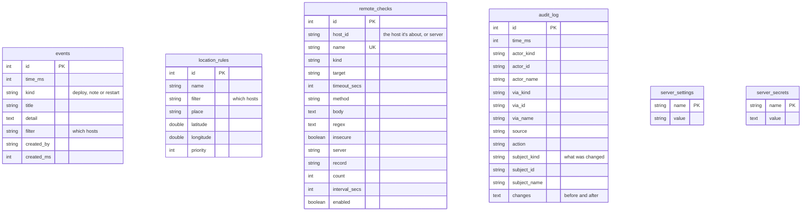
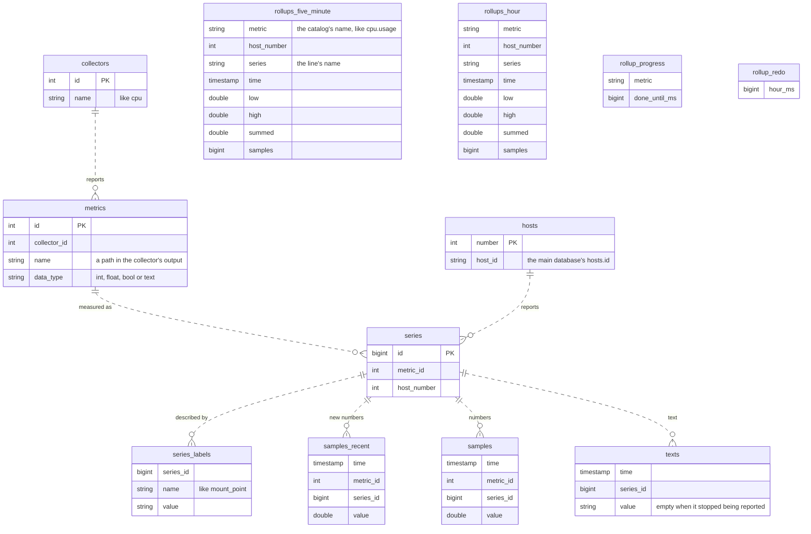
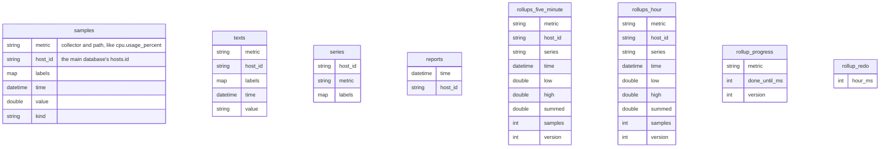

# Database design

MaxNines keeps its data in two places:

- **The main database** holds everything people set up and everything the server
  decides: hosts, facts, rules, alerts, users and the rest. It's SQLite by default,
  or PostgreSQL, MySQL or MariaDB, through sea-orm. Its migrations are in
  [`crates/server/src/migrations`](../crates/server/src/migrations/mod.rs).
- **The metrics store** holds the numbers hosts report. It's DuckDB for a single
  server or ClickHouse for a big one, and only one of them is used. Their
  migrations are in
  [`crates/server/src/store/migrations`](../crates/server/src/store/migrations) for
  DuckDB, and at the top of
  [`crates/server/src/store/clickhouse.rs`](../crates/server/src/store/clickhouse.rs)
  for ClickHouse.

The two only meet through a host's ID: the main database's `hosts.id` is the
metrics store's `host_id`.

These diagrams have to change with every change to a table.

## Main database

Every line is a foreign key the database enforces. Types are shown simply:
`string` has a length limit, `text` doesn't, and every time ending `_ms` is
milliseconds since 1970 in UTC.

```mermaid
erDiagram
    hosts ||--o{ host_facts : "reports"
    hosts ||--o| host_config_status : "last applied"
    hosts ||--o| host_boots : "last booted"
    hosts ||--o{ metrics_pages : "is read from"
    hosts ||--o{ alerts : "has"
    alert_rules |o--o{ alerts : "raised"
    alert_rules ||--o{ alert_rule_channels : "tells"
    notification_channels ||--o{ alert_rule_channels : "told by"
    alert_rules ||--o{ alert_rule_actions : "runs"
    hosts ||--o{ action_runs : "ran"
    alerts |o--o{ action_runs : "asked for"
    alerts ||--o{ notifications : "sent as"
    action_runs |o--o{ notifications : "printed for"
    notification_channels ||--o{ notifications : "sends"
    alert_rules |o--o{ silences : "silenced by"
    alert_rules |o--o{ maintenance_windows : "paused by"
    config_rules ||--o{ config_rule_settings : "sets"
    dashboards ||--o{ dashboard_widgets : "shows"
    dashboards ||--o{ dashboard_variables : "offers"
    users ||--o{ user_sessions : "signed in as"
    users ||--o{ api_keys : "owns"
    users ||--o{ recovery_codes : "can recover with"
    users ||--o{ sign_in_challenges : "is asked"

    hosts {
        string id PK "from its agent's public key, or random"
        string kind "agent, agentless or built_in"
        string public_key "empty without an agent"
        string hostname
        string state "pending, approved or revoked"
        text decided_by
        int first_seen_ms
        int decided_ms
    }
    metrics_pages {
        int id PK
        string host_id FK
        string url
        text names "the metrics to keep, one to a line"
        int interval_secs
        boolean enabled
        string username
        text password "as typed, when it was"
        string password_env "the server's variable holding it"
    }
    host_facts {
        int id PK
        string host_id FK
        string name "like os.family"
        string value
        string value_type
        int valid_from_ms
        int valid_to_ms "empty while current"
    }
    host_config_status {
        string host_id PK, FK
        string version
        text error
        int reported_ms
    }
    host_boots {
        string host_id PK, FK
        int boot_ms
    }
    alert_rules {
        int id PK
        string name "unique among those not deleted"
        string kind "metric, calculation, forecast or offline"
        string metric
        string series
        string comparison
        double threshold
        double warning_threshold
        int for_secs
        string severity
        text condition_expr "CEL, over facts"
        boolean enabled
        boolean all_channels
        string calculation
        string group_by
        string filter
        int window_secs
        int remind_every_secs
        int forecast_secs
        int warning_forecast_secs
        int deleted_ms "kept so alerts can name it"
    }
    alerts {
        int id PK
        int rule_id FK "the rule that raised it, even once deleted"
        string rule_name
        string severity
        string host_id FK
        string hostname
        string series
        double value
        text summary
        int started_ms
        int resolved_ms "empty while open"
        text resolve_reason
        string acknowledged_by
        int acknowledged_ms
    }
    notification_channels {
        int id PK
        string name "unique among those not deleted"
        string kind
        text target
        text credential "never shown back"
        text app_token "never shown back"
        boolean sends_warnings
        boolean sends_critical
        string mail_from
        string mail_hostname
        int mail_port
        string mail_security
        string mail_username
        string request_method
        string request_content_type
        text request_body
        int deleted_ms "kept so notifications can name it"
    }
    alert_rule_channels {
        int rule_id PK, FK
        int channel_id PK, FK
    }
    alert_rule_actions {
        int id PK
        int rule_id FK
        string action "a name agents report"
        string run_on "first, warning or critical"
        int timeout_secs
        int position
    }
    action_runs {
        int id PK
        string host_id FK
        int alert_id FK "empty for one a person started"
        string action
        string run_on "first, warning, critical or manual"
        text variables "JSON, what it was given"
        string requested_by
        int requested_ms
        int timeout_secs
        string outcome "empty while waiting"
        int exit_code
        text error
        text output "what it printed"
        boolean truncated
        int duration_ms
        int finished_ms
    }
    notifications {
        int id PK
        int alert_id FK
        int channel_id FK
        string event
        string state "pending, sent or failed"
        int attempts
        int next_attempt_ms
        text last_error
        int created_ms
        int sent_ms
        string external_id
        int action_run_id "the run it's about, for what an action printed"
    }
    silences {
        int id PK
        int rule_id FK "empty for every rule"
        string filter
        string reason
        string created_by
        int starts_ms
        int ends_ms
    }
    maintenance_windows {
        int id PK
        string name
        int rule_id FK "empty for every rule"
        string filter
        string days
        string start_time
        int duration_secs
        string time_zone
    }
    config_rules {
        int id PK
        string name UK
        int priority
        text condition_expr "CEL, over facts"
        boolean enabled
    }
    config_rule_settings {
        int id PK
        int rule_id FK
        string name
        string value
        string value_type
    }
    dashboards {
        int id PK
        string name
        int created_ms
    }
    dashboard_widgets {
        int id PK
        int dashboard_id FK
        string title
        string kind
        string metric
        string calculation
        string group_by
        string filter
        int x
        int y
        int w
        int h
    }
    dashboard_variables {
        int id PK
        int dashboard_id FK
        int position
        string name
        string label
        string kind "host or fact"
        string fact
        string filter
    }
    users {
        int id PK
        string email UK
        string name
        string password_hash
        string role
        string theme
        string time_zone
        string setup_token_hash UK
        int setup_expires_ms
        string totp_secret
        boolean totp_enabled
        int totp_last_step
        int created_ms
        int last_sign_in_ms
        int disabled_ms
    }
    user_sessions {
        int id PK
        int user_id FK
        string token_hash UK
        int created_ms
        int expires_ms
    }
    api_keys {
        int id PK
        int user_id FK
        string name
        string hint
        string token_hash UK
        string role
        int created_ms
        int expires_ms
        int last_used_ms
        int revoked_ms
    }
    recovery_codes {
        int id PK
        int user_id FK
        string code_hash
        int used_ms
    }
    sign_in_challenges {
        int id PK
        int user_id FK
        string token_hash UK
        int expires_ms
    }
```

Some tables stand alone. They name what they cover with a filter, which is
matched against hosts whenever it's used rather than stored as a reference, or
they're settings:

| Table | What it holds |
| --- | --- |
| `hosts` | Every host whose agent has asked to join, with whether it's approved, and every host added without an agent. Two built-in hosts, `server` and `fleet`, stand for the server itself and for alerts about many hosts at once |
| `metrics_pages` | The OpenMetrics pages the server reads for hosts without an agent, with how to sign in to each |
| `host_facts` | What each host's agent reports about it, kept as history: a fact changing closes one row and starts another |
| `host_config_status` | The config each host's agent last applied, and why if it refused one |
| `host_boots` | When each host last started, to notice restarts |
| `config_rules`, `config_rule_settings` | What agents monitor, chosen by facts |
| `alert_rules`, `alert_rule_channels` | What raises an alert, and who hears of it. A deleted rule is kept, marked by `deleted_ms`, so its alerts still name it |
| `alerts` | Every alert, open or resolved, with the hostname it had at the time |
| `alert_rule_actions` | The actions each rule runs on an alert's host, and when in the alert's life |
| `action_runs` | Every time an action was asked of a host, by an alert or a person, and what it printed. They go with their alert or their host |
| `notification_channels`, `notifications` | Where alerts are sent, and each delivery with its retries. A deleted channel is kept the same way, so what was sent through it still names it |
| `silences`, `maintenance_windows` | When notifications are held back |
| `events` | Annotations people and automations add, and restarts the server notices |
| `dashboards`, `dashboard_widgets`, `dashboard_variables` | Dashboards and what's on them |
| `location_rules` | Where hosts are on the map |
| `remote_checks` | Checks the server runs itself, each about a host without an agent or the server. `host_id` has no foreign key, as SQLite can't add one to a table that exists, so deleting a host deletes its checks |
| `users`, `user_sessions`, `api_keys`, `recovery_codes`, `sign_in_challenges` | People, how they sign in, and their keys |
| `audit_log` | Who changed what |
| `server_settings`, `server_secrets` | Settings for the whole server, and secrets it generates |

sea-orm adds `seaql_migrations`, which records the migrations that have run.

## Metrics store: DuckDB

Numbers are stored by series: a collector reports metrics, and each metric on
each host, for each thing it describes, is a series. New numbers land in
`samples_recent` and move to `samples` once their hour is over, sorted so a
query only reads what it needs. Rollups keep the lowest, highest, total and count
of each chart's line, 5 minutes and an hour at a time, so long ranges are quick
and spikes survive. A host is numbered here to keep series small. The lines are
references the server keeps: there are no foreign keys, as DuckDB checks them
slowly.

The view `all_samples` is `samples` and `samples_recent` together, and
`schema_migrations` records the migrations that have run.

## Metrics store: ClickHouse

ClickHouse keeps the same things without numbering them: each row names its
metric, host ID and labels in full, which it compresses well. Tables are sorted so
a query reads only what it asks for, and `ReplacingMergeTree` drops repeated rows
as it merges them.

`series` lists what exists, to limit what a host can create without reading the
samples, and `reports` says when each host last reported. `schema_migrations`
records the migrations that have run.
