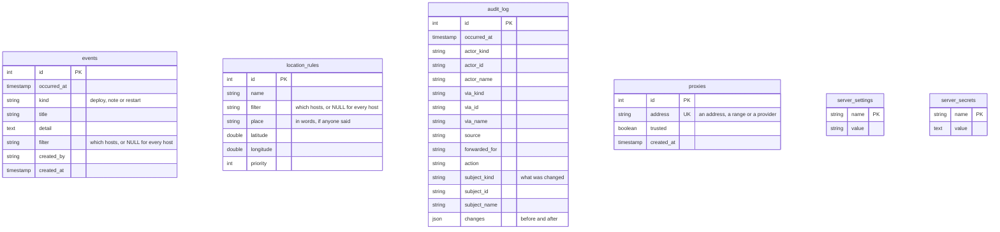
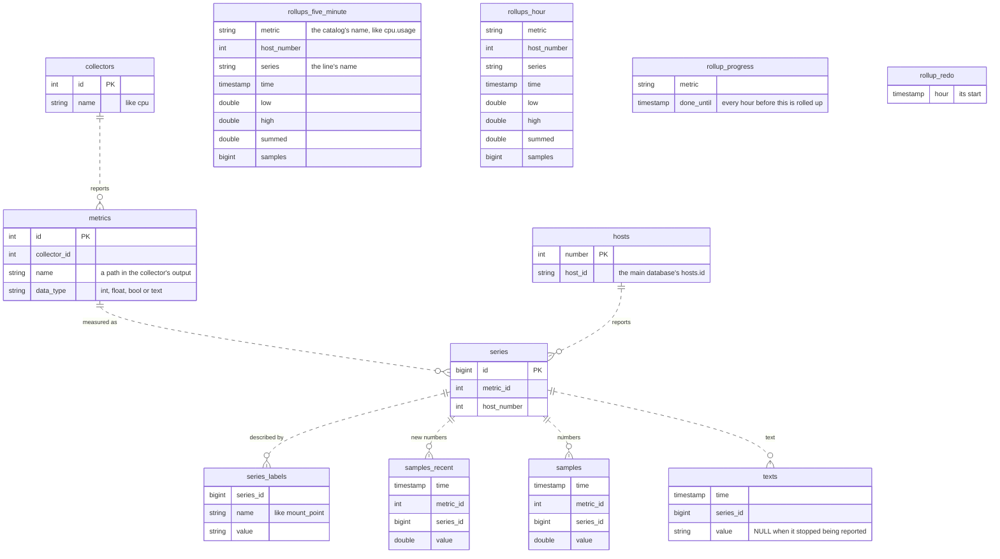
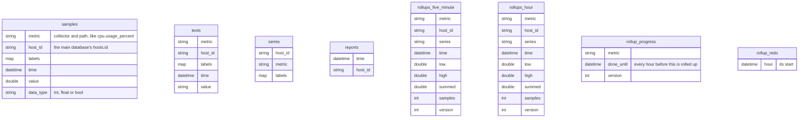

# Database design

MaxNines keeps its data in two places:

- **The main database** holds everything people set up and everything the server
  decides: hosts, facts, rules, alerts, users and the rest. It's SQLite by default,
  or PostgreSQL, MySQL or MariaDB, through sea-orm. One migration,
  `m20261119_000001_create_tables` in
  [`crates/server/src/migrations`](../crates/server/src/migrations/mod.rs), makes its
  tables and adds the built-in hosts. The built-in config rules and templates, and the
  alert rules templates have, are written each time the server starts.
- **The metrics store** holds the numbers hosts report. It's DuckDB for a single
  server or ClickHouse for a big one, and only one of them is used. Each has one
  migration, `0001_create_tables`, which makes its tables: in
  [`crates/server/src/store/migrations`](../crates/server/src/store/migrations) for
  DuckDB, and at the top of
  [`crates/server/src/store/clickhouse.rs`](../crates/server/src/store/clickhouse.rs)
  for ClickHouse.

The two only meet through a host's ID: the main database's `hosts.id` is the
metrics store's `host_id`.

These diagrams have to change with every change to a table. Until the first
release there are no upgrade steps: a change to a table is made to the migration
that makes it, and a database made before the change is deleted and made again.

## Main database

Every line is a foreign key the database enforces. Types are shown simply:
`string` has a length limit, `text` doesn't, and every `timestamp` is a moment in UTC to
the millisecond: `timestamptz` on PostgreSQL, `DATETIME(3)` on MySQL and MariaDB, and ISO
8601 text such as `2026-11-19T01:57:17.828+00:00` on SQLite, which has no type for it
and sorts it as text. A length of time ending `_ms` or `_secs` is a number. `json` is
`jsonb` on PostgreSQL, `json` on MySQL and MariaDB, and text on SQLite. A column that
can be empty is NULL when it is, never an empty string. A fact's `name` and `value` are
what agents report, compared exactly on every database: on MySQL and MariaDB by the
`utf8mb4_bin` collation, rather than the table's.

Names people give alert rules, channels, config rules and checks are compared ignoring
case and the spaces around them, as people read them. Each of those tables has a
`name_key`, the name as it's compared, which the server fills in and the database
keeps unique, comparing it exactly on every database, so they all agree.

What a row goes with is the database's to say. Deleting a host deletes its facts,
config status, boot time, metrics pages, checks, alerts, alert holds and action runs; deleting a
user deletes their sessions, keys, app sign-ins, recovery codes and sign-in
challenges; deleting an alert deletes its notifications and action runs, and deleting
an action run the notifications of what it printed. Alert rules, channels and templates
are only ever marked deleted, so what they raised and sent still names them: the
database refuses to delete one an alert, notification or rule points at. A link between a rule and a
channel, a rule's actions, silences and maintenance windows, a config rule's settings
and a dashboard's widgets and variables go with what they belong to.

```mermaid
erDiagram
    hosts ||--o{ host_facts : "reports"
    hosts ||--o| host_config_status : "last applied"
    hosts ||--o| host_boots : "last booted"
    hosts ||--o{ metrics_pages : "is read from"
    hosts ||--o{ remote_checks : "is checked by"
    remote_checks ||--o| heartbeats : "pinged with"
    remote_checks ||--o{ unifi_devices : "found"
    hosts ||--o| unifi_devices : "kept as"
    hosts ||--o{ alerts : "has"
    templates |o--o{ alert_rules : "alerts as"
    alert_rules |o--o| alert_rules : "copied as"
    templates ||--o{ template_discoveries : "discovers with"
    template_discoveries ||--o{ template_registry_reads : "reads"
    templates ||--o{ template_notices : "notes"
    templates ||--o{ template_queries : "queries"
    hosts ||--o{ template_errors : "goes wrong reading"
    templates ||--o{ template_errors : "goes wrong in"
    template_queries ||--o{ template_fills : "fills"
    template_fills ||--o{ template_fill_versions : "by version"
    templates ||--o{ template_counters : "counts"
    template_queries |o--o{ template_metrics : "gives"
    templates ||--o{ template_hosts : "given by hand"
    hosts ||--o{ template_instances : "runs templates for"
    templates ||--o{ template_instances : "runs for"
    template_instances ||--o{ template_instance_values : "found"
    hosts ||--o{ template_hosts : "given"
    templates ||--o{ template_renames : "was called"
    templates ||--o{ template_services : "watches"
    template_discoveries ||--o{ template_counter_sets : "looks for"
    template_registry_reads ||--o{ template_registry_values : "reads"
    template_queries ||--o{ template_query_labels : "labels by"
    template_queries ||--o{ template_query_columns : "names a SHOW statement's or MongoDB's columns"
    template_discoveries ||--o{ template_discovery_columns : "names MongoDB's columns"
    template_counters ||--o{ template_counters_excludes : "leaves out"
    template_counters ||--o{ template_counters_groups : "groups by"
    template_metrics ||--o{ template_metric_states : "says"
    template_counters |o--o{ template_metrics : "gives"
    alert_rules ||--o{ alerts : "raised"
    alert_rules ||--o{ alert_holds : "waiting on"
    hosts ||--o{ alert_holds : "crossed on"
    alert_rules ||--o{ alert_rule_channels : "tells"
    notification_channels ||--o{ alert_rule_channels : "told by"
    alert_rules ||--o{ alert_rule_actions : "runs"
    hosts ||--o{ action_runs : "ran"
    alerts |o--o{ action_runs : "asked for"
    alerts ||--o{ notifications : "sent as"
    action_runs |o--o{ notifications : "printed for"
    notification_channels ||--o{ notifications : "sends"
    alert_rules |o--o{ silences : "silenced by"
    alert_rules |o--o{ maintenance_windows : "paused by"
    config_rules ||--o{ config_rule_settings : "sets"
    dashboards ||--o{ dashboard_widgets : "shows"
    dashboards ||--o{ dashboard_variables : "offers"
    users ||--o{ user_sessions : "signed in as"
    users ||--o{ api_keys : "owns"
    users ||--o{ app_sign_ins : "signed in"
    users ||--o{ recovery_codes : "can recover with"
    users ||--o{ sign_in_challenges : "is asked"

    hosts {
        string id PK "from its agent's public key, or random"
        string kind "agent, agentless or built_in"
        string public_key "NULL without an agent"
        string hostname
        string state "pending, approved or revoked"
        text decided_by
        timestamp first_seen_at
        timestamp decided_at
        timestamp refused_at "while its agent is refused for its protocol, since when"
        text refused_reason "what its agent was told"
        int refused_protocol "the protocol its agent speaks"
    }
    metrics_pages {
        int id PK
        string host_id FK
        string url
        text names "the metrics to keep, one to a line, or NULL for all"
        int interval_secs
        boolean enabled
        string username
        text password "as typed, when it was"
        string password_env "the server's variable holding it"
        text token "as typed, for a page that takes one instead"
        string token_env "the server's variable holding it"
    }
    host_facts {
        int id PK
        string host_id FK
        string name "like os.family"
        string value
        string value_type
        timestamp valid_from
        timestamp valid_to "NULL while current"
    }
    host_config_status {
        string host_id PK, FK
        string version
        text error
        timestamp reported_at
        text skipped_collectors "the agent doesn't know them, one to a line, NULL for none"
    }
    host_boots {
        string host_id PK, FK
        timestamp booted_at
    }
    alert_rules {
        int id PK
        string name
        string name_key "unique among those not deleted"
        text warning "CEL over metrics by name, when it's a warning"
        text critical "the same, when it's critical"
        text summary "Tera, what alerts say, or NULL for the usual"
        text resolved_summary "the same, as they clear"
        int for_secs
        text applies_to "CEL, over facts"
        boolean enabled
        boolean all_channels
        string calculation "NULL for a rule about each host"
        string metric "what a calculation combines"
        string group_by
        string filter
        int window_secs
        int remind_every_secs
        int template_id FK "the template whose alert it is, or NULL"
        string template_alert "which of its alerts, by key"
        boolean enabled_choice "for a template's rule, what someone chose in place of what it ships, or NULL to follow it"
        int replaces_id FK "for someone's copy, the built-in template's rule it's used in place of"
        int template_position "where it comes among the template's alerts"
        text when_condition "a template's alert: CEL over what discovery found"
        string since "a template's alert: the version it's from"
        timestamp original_changed_at "when an upgrade last changed the rule a copy replaces"
        timestamp deleted_at "kept so alerts can name it"
    }
    templates {
        int id PK
        string key "starts its metrics' names, unique among those not deleted"
        string name
        string name_key "unique among those not deleted"
        text description
        string origin "built_in, imported or own"
        string target_kind "database, service or os, or NULL for every host"
        string target "the kind of database, the service, or systems, comma separated"
        text applies_to "CEL over facts saying which hosts it's for, as it ships, or NULL for all"
        text applies_to_choice "what someone chose instead, for a built-in or imported one, NULL for no condition"
        boolean applies_to_chosen "whether they chose, so applies_to_choice is used"
        string min_version
        string fingerprint "a hash of what a built-in or imported one says, or NULL"
        boolean enabled "whether it ships on, for a built-in or imported one"
        boolean enabled_choice "what someone chose instead, or NULL to follow it"
        timestamp created_at
        timestamp updated_at
        timestamp upgraded_at "when a newer version last changed a built-in or imported one"
        boolean upgrade_seen "whether admins dismissed the notice of it"
        text upgrade_note "what else that notice says, such as what became of copies"
        timestamp deleted_at "kept so its rules can name it"
    }
    template_instances {
        int id PK
        string host_id FK
        int template_id FK
        string database_name "the database in the agent's config, or empty on the host itself, unique with host and template"
        timestamp discovered_at "the time of the sample that last said what discovery found"
    }
    template_instance_values {
        int id PK
        int instance_id FK
        string name "a column, registry value or counter set discovery found, unique with instance_id"
        text value
        string value_type "string, number or boolean, as facts have"
    }
    template_hosts {
        int id PK
        int template_id FK
        string host_id FK "unique with template_id"
    }
    template_discoveries {
        int id PK
        int template_id FK
        string key
        int position
        int replaces_id FK
        int interval_secs
        text sql "or MongoDB's command, as JSON"
        timestamp original_changed_at "on a copy, when a newer version changed the part it copies"
    }
    template_registry_reads {
        int id PK
        int discovery_id FK
        int replaces_id FK
        string key "the registry key"
        int position
    }
    template_notices {
        int id PK
        int template_id FK
        int replaces_id FK
        string key
        int position
        text when_condition
        text text
    }
    template_errors {
        int id PK
        string host_id FK
        int template_id FK
        string database_name "empty for one on the host"
        string part "connecting, account, or a part such as query sessions"
        text message
        timestamp since "when it first said this"
    }
    template_queries {
        int id PK
        int template_id FK
        int replaces_id FK
        string key
        int position
        text sql "or MongoDB's command, as JSON"
        text rows_path "MongoDB: where in the reply its rows are"
        int interval_secs
        string since
        text when_condition
        boolean enabled
        boolean enabled_choice
        timestamp original_changed_at "on a copy, when a newer version changed the part it copies"
    }
    template_fills {
        int id PK
        int query_id FK
        int replaces_id FK
        string key
        int position
        text older "the SQL below every version"
    }
    template_fill_versions {
        int id PK
        int fill_id FK
        int replaces_id FK
        string version
        int position
        text sql
    }
    template_counters {
        int id PK
        int template_id FK
        int replaces_id FK
        string key
        int position
        string object "the counter set"
        string label
        text pattern
        string instance
        string join_object
        text join_pattern
        text when_condition
        string since
        int interval_secs
        boolean enabled
        boolean enabled_choice
        timestamp original_changed_at "on a copy, when a newer version changed the part it copies"
    }
    template_renames {
        int id PK
        int template_id FK
        string old_key "a key the template had before"
        int position
    }
    template_services {
        int id PK
        int template_id FK
        string service "one the host's alerts should watch"
        int position
    }
    template_counter_sets {
        int id PK
        int discovery_id FK
        string key "what it's found as"
        int position
        text counter_set
    }
    template_registry_values {
        int id PK
        int registry_read_id FK
        string key "what it's found as"
        int position
        text value_name
    }
    template_query_labels {
        int id PK
        int query_id FK
        string label "a column that tells rows apart"
        int position
    }
    template_query_columns {
        int id PK
        int query_id FK
        string name "what it's read as"
        text source "the SHOW statement's column, or where in MongoDB's reply"
        int position
    }
    template_discovery_columns {
        int id PK
        int discovery_id FK
        string name "what it's found as"
        text source "where in MongoDB's reply"
        int position
    }
    template_counters_excludes {
        int id PK
        int counters_id FK
        string instance "one left out"
        int position
    }
    template_counters_groups {
        int id PK
        int counters_id FK
        string key "the group"
        int position
        text counter "the counter its value is read from"
    }
    template_metric_states {
        int id PK
        int metric_id FK
        string number
        int position
        text word
    }
    template_metrics {
        int id PK
        int query_id FK "its query, or"
        int counters_id FK "its counters"
        int replaces_id FK
        string key
        int position
        string title "what charts call it"
        string counter
        string unit
        boolean total
        text description
        text value "CEL working it out"
        string since
    }
    alerts {
        int id PK
        int rule_id FK "the rule that raised it, even once deleted"
        string severity
        string host_id FK
        string series "NULL for the host as a whole"
        double value
        text summary
        timestamp started_at "when it fired"
        timestamp breached_at "when the problem began"
        timestamp resolved_at "NULL while open"
        text resolve_reason
        text resolved_summary
        string acknowledged_by
        timestamp acknowledged_at
    }
    alert_holds {
        int id PK
        int rule_id FK
        string host_id FK
        string series "empty for the host as a whole"
        string severity "which of the rule's levels"
        timestamp breached_since "unique by rule, host, series and level"
    }
    notification_channels {
        int id PK
        string name
        string name_key "unique among those not deleted"
        string kind
        text target
        text credential "never shown back"
        text app_token "never shown back"
        boolean sends_warnings
        boolean sends_critical
        string mail_from
        string mail_hostname
        int mail_port
        string mail_security
        string mail_username
        string request_method
        string request_content_type
        text request_body
        string region "PagerDuty's service region, us or eu"
        timestamp deleted_at "kept so notifications can name it"
    }
    alert_rule_channels {
        int rule_id PK, FK
        int channel_id PK, FK
    }
    alert_rule_actions {
        int id PK
        int rule_id FK
        string action "a name agents report"
        string run_on "first, warning or critical"
        int timeout_secs
        int position
    }
    action_runs {
        int id PK
        string host_id FK
        int alert_id FK "NULL for one a person started"
        string action
        string run_on "first, warning, critical or manual"
        json variables "what it was given"
        string requested_by
        timestamp requested_at
        int timeout_secs
        string outcome "NULL while waiting"
        int exit_code
        text error
        text output "what it printed"
        boolean truncated
        double duration_secs "how long it ran, with a fraction"
        timestamp finished_at
    }
    notifications {
        int id PK
        int alert_id FK
        int channel_id FK
        string event "firing, escalated, eased, reminder, resolved, action or acknowledged"
        string state "pending, held, sent or failed"
        int attempts
        timestamp next_attempt_at
        text last_error
        timestamp created_at
        timestamp sent_at
        string external_id "what the service called it, such as a message, or the incident an on-call service has open"
        int action_run_id FK "the run it's about, for what an action printed"
    }
    silences {
        int id PK
        int rule_id FK "NULL for every rule"
        string filter "which hosts, or NULL for every host"
        string series "the one series it's for, or NULL"
        string reason
        string created_by
        timestamp starts_at
        timestamp ends_at
    }
    maintenance_windows {
        int id PK
        string name
        int rule_id FK "NULL for every rule"
        string filter "which hosts, or NULL for every host"
        string days
        string start_time
        int duration_secs
        string time_zone
    }
    config_rules {
        int id PK
        string name
        string name_key UK
        int priority
        text applies_to "CEL, over facts"
        boolean enabled
        string operating_systems "comma separated, or null for all"
        string built_in "key of a rule that ships with the server"
        timestamp built_in_changed_at "when an upgrade last changed it"
    }
    config_rule_settings {
        int id PK
        int rule_id FK
        string name
        string value
        string value_type
    }
    dashboards {
        int id PK
        string name
        timestamp created_at
    }
    dashboard_widgets {
        int id PK
        int dashboard_id FK
        string title "NULL uses the metric's name"
        string kind
        string metric
        string calculation
        string group_by
        string filter "which hosts, or NULL for every host"
        int x
        int y
        int w
        int h
    }
    dashboard_variables {
        int id PK
        int dashboard_id FK
        int position
        string name
        string label "NULL uses the name"
        string kind "host or fact"
        string fact "NULL for a host variable"
        string filter "which hosts, or NULL for every host"
    }
    remote_checks {
        int id PK
        string host_id FK "the host without an agent it's about"
        string name
        string name_key "one to a host"
        string kind
        string target
        int timeout_secs
        string method
        text body
        text regex
        boolean insecure
        string server
        string record
        int count
        int interval_secs
        boolean enabled
        string database "postgres: which one to sign in to"
        boolean tls "mysql, redis"
        string host_key "ssh: the fingerprint expected"
        string username
        text password "as typed, when it was"
        string password_env "the server's variable holding it"
        text private_key "ssh: as typed, when it was"
        string private_key_env "the server's variable holding it"
        boolean domain_expiry "http: false to not look it up"
        boolean read_stats "databases: read health and replication too"
        int grace_secs "heartbeat: how late a ping can be"
        string ping_token UK "heartbeat: in the address it's pinged at"
        string site "unifi: the one site to read"
        text api_key "unifi: as typed, when it was"
        string api_key_env "the server's variable holding it"
    }
    unifi_devices {
        int id PK
        int remote_check_id FK "the UniFi check that found it"
        string device_id "the console's ID for it"
        string host_id FK "the host without an agent it's kept as"
    }
    heartbeats {
        int remote_check_id PK, FK
        timestamp pinged_at "when a run last finished or failed"
        boolean failed "whether that run failed"
        timestamp started_at "when the run under way started"
        double run_secs "how long the last timed run took"
    }
    users {
        int id PK
        string email UK
        string name
        string password_hash
        string role
        string theme
        string time_zone
        string setup_token_hash UK
        timestamp setup_expires_at
        string totp_secret
        boolean totp_enabled
        int totp_last_step
        timestamp created_at
        timestamp last_sign_in_at
        timestamp disabled_at
    }
    user_sessions {
        int id PK
        int user_id FK
        string token_hash UK
        timestamp created_at
        timestamp expires_at
        timestamp last_used_at
        string last_address
        string user_agent
        string last_forwarded_for
    }
    api_keys {
        int id PK
        int user_id FK
        string name
        string hint
        string token_hash UK
        string role
        timestamp created_at
        timestamp expires_at
        timestamp last_used_at
        string last_address
        string last_forwarded_for
        timestamp revoked_at
    }
    app_sign_ins {
        int id PK
        int user_id FK
        string client_id "or its client metadata document's address"
        string client_name "what that document calls it"
        string device "what the app calls its computer, if it said"
        string role
        string access_hash UK
        timestamp access_expires_at
        string refresh_hash UK
        string previous_refresh_hash
        timestamp rotated_at
        timestamp refresh_expires_at
        timestamp created_at
        timestamp last_used_at
        string last_address
        string last_forwarded_for
        timestamp revoked_at
    }
    recovery_codes {
        int id PK
        int user_id FK
        string code_hash
        timestamp used_at
    }
    sign_in_challenges {
        int id PK
        int user_id FK
        string token_hash UK
        timestamp expires_at
    }
```

Some tables stand alone. They name what they cover with a filter, which is
matched against hosts whenever it's used rather than stored as a reference, or
they're settings:



| Table | What it holds |
| --- | --- |
| `hosts` | Every host whose agent has asked to join, with whether it's approved, and every host added without an agent. Two built-in hosts, `server` and `fleet`, stand for the server itself and for alerts about many hosts at once |
| `metrics_pages` | The OpenMetrics pages the server reads for hosts without an agent, with how to sign in to each |
| `host_facts` | What each host's agent reports about it, kept as history: a fact changing closes one row and starts another |
| `host_config_status` | The config each host's agent last applied, why if it refused one, and the collectors in it the agent doesn't know |
| `host_boots` | When each host last started, to notice restarts |
| `config_rules`, `config_rule_settings` | What agents monitor, chosen by operating system and facts. The server writes its built-in rules, marked by `built_in`, each time it starts |
| `alert_rules`, `alert_rule_channels` | What raises an alert, and who hears of it. A deleted rule is kept, marked by `deleted_at`, so its alerts still name it. A template's alert is a rule too. A built-in or imported template's rule isn't people's to change, and is rewritten by a newer version, `enabled` included, which is what it ships: what someone chose instead is in `enabled_choice`, which a newer version never writes; someone changing it makes a copy of their own, a second rule whose `replaces_id` points at it, which is used in its place until it's deleted. Making or deleting a copy hands the open alerts, silences and maintenance windows of one to the other |
| `templates` | What MaxNines watches for in something it monitors: by `origin`, the built-in ones, which the server writes each time it starts, imported ones, which importing a newer version rewrites the same way, and people's own. HCL is only how they come in and go out. A deleted one is kept, marked by `deleted_at`, as its rules point at it |
| `template_renames`, `template_services`, `template_counter_sets`, `template_registry_values`, `template_query_labels`, `template_query_columns`, `template_discovery_columns`, `template_counters_excludes`, `template_counters_groups`, `template_metric_states` | The short lists and maps of a template and its parts, a row to an item, in order by `position`, written over the rows they have by the item's name as the parts are. A copy of a part brings its items with it, so they have no `replaces_id` of their own. None of a template is kept as JSON |
| `template_errors` | What's going wrong reading each template for each database a host reads, or on the host with an empty `database_name`: a row to each thing that went wrong last time, by `part`, with the `message` the database or Windows gave and `since`, when it first said it. Agents, and the server for hosts with no agent, say it whenever it changes, and what they say replaces what was kept for that template and database, so only what's wrong now is kept; the same message keeps its `since`. A sample older than one already said of the same template and database, as one an agent kept while away, is let go. It's forgotten with what discovery found when the host no longer reads the template there, and goes with its host or template |
| `template_discoveries`, `template_registry_reads`, `template_notices`, `template_queries`, `template_fills`, `template_fill_versions`, `template_counters`, `template_metrics` | A template's parts, one row to a block or entry, each with its key as the HCL has it and its `position` among the others. A save, an import or a start writes each part over the row with its key, within its template, query, counters or fill, so a row keeps its `id` while its part is there, and only the rows of parts that are gone are deleted. A fill's versions are matched by `version`, and a part given another key is a new part. They go with their template, query, counters or fill. Each has a `replaces_id` for someone's own copy of a built-in or imported template's part, as alert rules have. A copy of a discover block, query or counters block is a second row, with the rows of its own fills, versions, metrics and items, whose `replaces_id` points at the template's own, used in its place until it's reset; `original_changed_at` on it says when a newer version changed the part it copies, and a part a newer version drops takes its copy with it. Whether a query or counters block is on is only ever the template's own row's `enabled` and `enabled_choice`, which a newer version never writes |
| `alerts` | Every alert, open or resolved. Its rule's name and its host's are read from them, so it shows what they're called now. A host's alerts go with it |
| `alert_rule_actions` | The actions each rule runs on an alert's host, and when in the alert's life |
| `action_runs` | Every time an action was asked of a host, by an alert or a person, and what it printed. They go with their alert or their host |
| `notification_channels`, `notifications` | Where alerts are sent, and each delivery with its retries. A deleted channel is kept the same way, so what was sent through it still names it |
| `silences`, `maintenance_windows` | When notifications are held back |
| `events` | Annotations people and automations add, and restarts the server notices |
| `dashboards`, `dashboard_widgets`, `dashboard_variables` | Dashboards and what's on them |
| `location_rules` | Where hosts are on the map |
| `remote_checks` | Checks the server runs itself, each about a host without an agent, which is made for it if it's added without one, and with a name no other check about that host has. A host's checks go with it, and a check's host stays when the check goes |
| `unifi_devices` | Each device a UniFi check has found, with the host without an agent made for it, so a device keeps its host through renames on the console. It goes with its check or its host, and the host stays when the check goes |
| `heartbeats` | What each heartbeat check was last pinged with, made by its first ping, which is what lets one that's late stay late through a restart. It goes with its check, or when the check stops being a heartbeat |
| `users`, `user_sessions`, `api_keys`, `recovery_codes`, `sign_in_challenges` | People, how they sign in, and their keys. Each browser session, key and app sign-in keeps where it was last used from, for the list of who's signed in |
| `app_sign_ins` | Apps people signed in through the browser, such as the command line or an AI assistant, with hashes of the tokens each holds. A refresh token that's been swapped is kept a moment, so using it again can be told apart from a lost answer |
| `audit_log` | Who changed what |
| `server_settings`, `server_secrets` | Settings for the whole server, and secrets it generates |
| `proxies` | What admins decided about proxies in front of the server: trusted, or not a proxy. Where a proxy that isn't trusted said a request came from is kept beside the address that connected, as `forwarded_for`, in the audit log and on sessions, keys and app sign-ins |

sea-orm adds `seaql_migrations`, which records the migrations that have run.

### Indexes

Besides each table's primary key and the unique columns marked `UK`, these are what
the server's queries and foreign keys use. Those kept unique only among some rows,
such as rules that aren't deleted, index those rows alone on PostgreSQL and SQLite.
MySQL and MariaDB can't, so those tables also have a column the database works out,
holding what's kept unique for those rows and NULL for the rest, with a unique index
that lets NULL repeat: `live_name` on `alert_rules`, `notification_channels` and
`templates`, `live_key` on `templates`, `live_template_alert` and `live_replaces_id` on
`alert_rules`,
`current_name` on `host_facts` and `open_series` on `alerts`. Each compares exactly,
by the `utf8mb4_bin` collation, as the other databases do, rather than as the table's
collation would. MySQL and MariaDB also make an index for each foreign key that no
index here starts with.

| Index | Columns | For |
| --- | --- | --- |
| `idx_host_facts_host` | `host_facts (host_id, valid_to)` | A host's current facts |
| `idx_host_facts_current` | `host_facts (host_id, name)` where `valid_to` is NULL, unique | One current value of each fact for each host |
| `idx_host_facts_current_name` | `host_facts (name)` where `valid_to` is NULL; `(valid_to, name)` on MySQL | The facts every host has now |
| `idx_metrics_pages_host` | `metrics_pages (host_id)` | A host's pages |
| `idx_config_rules_name` | `config_rules (name_key)`, unique | One config rule to a name |
| `idx_config_rule_settings_rule_name` | `config_rule_settings (rule_id, name)`, unique | A config rule's settings |
| `idx_user_sessions_user_id` | `user_sessions (user_id)` | A user's sessions |
| `idx_user_sessions_expires` | `user_sessions (expires_at)` | Clearing sessions that ran out, on every sign in |
| `idx_api_keys_user_id` | `api_keys (user_id)` | A user's keys |
| `idx_app_sign_ins_user_id` | `app_sign_ins (user_id)` | A user's apps |
| `idx_app_sign_ins_previous_refresh_hash` | `app_sign_ins (previous_refresh_hash)` | A refresh token used again |
| `idx_app_sign_ins_revoked` | `app_sign_ins (revoked_at)` | Clearing apps revoked long ago, on every app sign in |
| `idx_app_sign_ins_refresh_expires` | `app_sign_ins (refresh_expires_at)` | Clearing apps whose sign in ran out long ago |
| `idx_recovery_codes_user_id` | `recovery_codes (user_id)` | A user's recovery codes |
| `idx_sign_in_challenges_user_id` | `sign_in_challenges (user_id)` | A user's challenges |
| `idx_sign_in_challenges_expires` | `sign_in_challenges (expires_at)` | Clearing challenges that ran out, on every sign in |
| `idx_alert_rules_live_name` | `alert_rules (name_key)` where `deleted_at` and `replaces_id` are NULL, unique | One rule to a name. A copy has its original's name until it's renamed, so the server checks copies' names itself |
| `idx_notification_channels_live_name` | `notification_channels (name_key)` where `deleted_at` is NULL, unique | One channel to a name |
| `idx_templates_live_name` | `templates (name_key)` where `deleted_at` is NULL, unique | One template to a name |
| `idx_templates_live_key` | `templates (key)` where `deleted_at` is NULL, unique | One template to a key |
| `idx_alert_rules_template_alert` | `alert_rules (template_id, template_alert)` where `deleted_at` and `replaces_id` are NULL and `template_id` isn't, unique | One rule to each of a template's alerts |
| `idx_alert_rules_replaces` | `alert_rules (replaces_id)` where `deleted_at` is NULL and `replaces_id` isn't, unique | One copy of a built-in template's rule |
| `idx_template_*` | Each part table by its template, query, counters or fill, and `position` | A template's parts in order |
| `idx_alert_rule_channels_channel` | `alert_rule_channels (channel_id)` | The rules telling a channel |
| `idx_alert_rule_actions_rule` | `alert_rule_actions (rule_id)` | A rule's actions |
| `idx_alerts_resolved` | `alerts (resolved_at, id)` | Open alerts, and those that ended most recently |
| `idx_alerts_started` | `alerts (started_at)` | Alerts newest first |
| `idx_alerts_host_started` | `alerts (host_id, started_at)` | A host's timeline, and its alerts |
| `idx_alerts_rule_resolved` | `alerts (rule_id, resolved_at)` | A rule's open alerts, to remind people or end them |
| `idx_alerts_open` | `alerts (rule_id, host_id, series)` where `resolved_at` is NULL, unique, with no series counting as one | One open alert from a rule about each host and series |
| `idx_notifications_alert` | `notifications (alert_id)` | An alert's notifications |
| `idx_notifications_due` | `notifications (state, next_attempt_at)` | What's due to be sent |
| `idx_notifications_channel` | `notifications (channel_id, state)` | What's waiting for a channel |
| `idx_notifications_action_run` | `notifications (action_run_id)` | What an action printed |
| `idx_notifications_problems` | `notifications (id)` where `last_error` isn't NULL | Deliveries that went wrong, newest first, on PostgreSQL and SQLite |
| `idx_action_runs_alert` | `action_runs (alert_id)` | An alert's runs |
| `idx_action_runs_host` | `action_runs (host_id, requested_at)` | A host's runs |
| `idx_action_runs_finished` | `action_runs (finished_at)` | Runs still waiting for an answer |
| `idx_remote_checks_host_name` | `remote_checks (host_id, name_key)`, unique | One check to a name for each host |
| `idx_remote_checks_ping_token` | `remote_checks (ping_token)`, unique | The heartbeat a ping is for |
| `idx_unifi_devices_check_device` | `unifi_devices (remote_check_id, device_id)`, unique | One host to a device for each check |
| `idx_silences_ends` | `silences (ends_at)` | Silences still running |
| `idx_dashboard_widgets_dashboard` | `dashboard_widgets (dashboard_id)` | A dashboard's widgets |
| `idx_dashboard_variables_dashboard` | `dashboard_variables (dashboard_id)` | A dashboard's variables |
| `idx_events_time` | `events (occurred_at)` | Events in a range of time |

## Metrics store: DuckDB

Numbers are stored by series: a collector reports metrics, and each metric on
each host, for each thing it describes, is a series. New numbers land in
`samples_recent` and move to `samples` once their hour is over, sorted so a
query only reads what it needs. Rollups keep the lowest, highest, total and count
of each chart's line, 5 minutes and an hour at a time, so long ranges are quick
and spikes survive. A host is numbered here to keep series small. Every moment is a
`TIMESTAMP` in UTC, to the millisecond. The numbers marked `PK` are primary keys,
which DuckDB keeps unique. The lines are references the server keeps: there are no
foreign keys, as DuckDB checks them slowly, and the tables of numbers have no keys or
indexes, as sorting them is what makes reading them quick.



The view `all_samples` is `samples` and `samples_recent` together, and
`schema_migrations` records the migrations that have run.

## Metrics store: ClickHouse

ClickHouse keeps the same things without numbering them: each row names its
metric, host ID and labels in full, which it compresses well. Tables are sorted so
a query reads only what it asks for, and `ReplacingMergeTree` drops repeated rows
as it merges them. Every moment is a `DateTime64(3, 'UTC')`.



`series` lists what exists, to limit what a host can create without reading the
samples, and `reports` says when each host last reported. A sample holding only the
server's reading of an agent's clock isn't a report, as that's saved whether or not
anything the agent sends is. `schema_migrations` records the migrations that have run.
